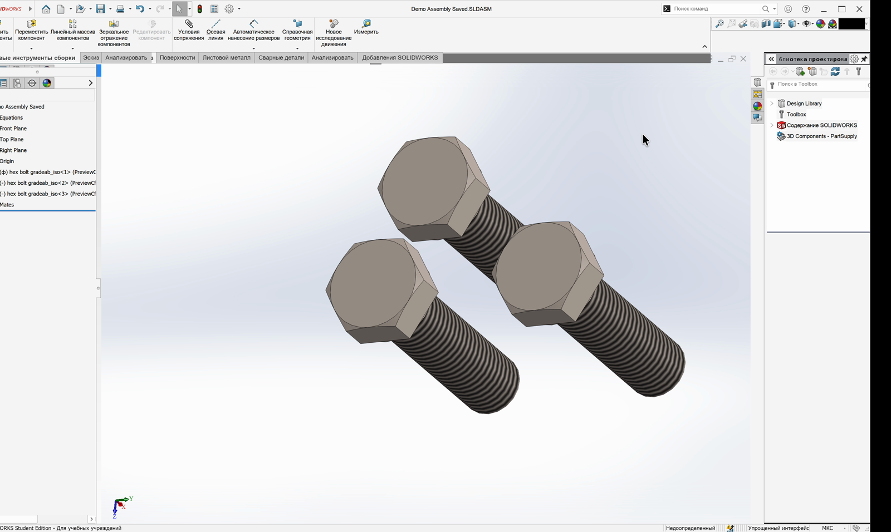
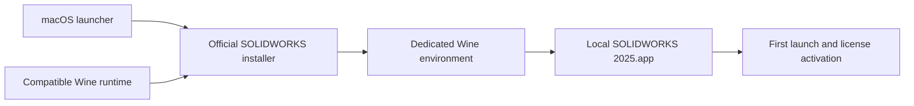

[English](README.md) · [Русский](README.ru.md)

# SOLIDWORKS 2025 on Apple Silicon

**V3 · Experimental support for running the Windows edition on macOS through Wine and Rosetta**

[Download the launcher](https://github.com/NazarKaratash13/Porting-Solidworks-2025-on-MacOS-in-Apple-Silicon/releases/tag/v0.2.0) · [Demo](#demo) · [Installation](#installation) · [Benchmarks](#benchmarks)

V3 runs the Windows edition of SOLIDWORKS on Apple Silicon without a Windows virtual machine. It integrates with Finder and macOS file dialogs. The launcher runs the official installer in a dedicated Wine environment, then packages the completed installation as a local `SOLIDWORKS 2025.app`. A valid SOLIDWORKS license is required.

## Demo

The 89-second demo shows startup, part rotation, insertion of a third ISO bolt from Toolbox, and saving and reopening the assembly. It ends with benchmark results from an M4 Mac. [Download the demo with Russian captions](https://github.com/NazarKaratash13/Porting-Solidworks-2025-on-MacOS-in-Apple-Silicon/releases/download/v0.2.0/SOLIDWORKS-V3-Demo-RU.mp4).

| Feature | Status |
| --- | --- |
| SOLIDWORKS 2025 SP05 Student Edition | Launched on an existing V3 installation on an M4 Mac |
| Parts, assemblies, and Toolbox | Inserted an ISO bolt, then saved and reopened the test assembly |
| Open, Save As, and Pack and Go | macOS dialogs integrated with SOLIDWORKS file operations |
| Finder | Quick Look displays embedded previews when the document contains one |
| Packaging into a single `.app` | Validated with a simulated installation. Clean installs across Wine distributions and license activation still need testing |
| Windows-to-ARM64 recompilation | Separate experimental work in this repository |

## Installation

You need a Mac with Apple Silicon, macOS 14 or later, Rosetta, a compatible Wine build with the V3 patches, the official SOLIDWORKS 2025 installer, and a license for your edition. The benchmarks used CrossOver 26.3.0. V3 features depend on the compatibility modules described in the [macOS build guide](docs/MACOS_BUILD.md).

1. Download the Apple Silicon DMG or ZIP and verify it against `SHA256SUMS.txt`. Open the DMG and drag the launcher into Applications. If you downloaded the ZIP, extract it and move the launcher into Applications. [Release downloads](https://github.com/NazarKaratash13/Porting-Solidworks-2025-on-MacOS-in-Apple-Silicon/releases/tag/v0.2.0).
2. Open the launcher and choose your Wine folder. You can also choose a projects folder, which Wine exposes as drive `W:`.
3. Click **Начать установку…** (Start installation), select `setup.exe` from the official distribution, and follow the SOLIDWORKS installer.
4. Choose a destination when the installer finishes. The launcher builds `SOLIDWORKS 2025.app` with its app icon, the selected Wine runtime, the installed program, and Finder extensions. Choose Applications if you have permission to write there.
5. Complete the normal license activation on first launch if SOLIDWORKS prompts you. Wine stores its working files in `~/Library/Application Support/org.swv3.desktop`.

The release launcher is ad hoc signed. Gatekeeper on another Mac may require a Developer ID signature and Apple notarization. You can also [build the launcher from source](docs/MACOS_BUILD.md#build-the-setup-launcher) or [package an existing compatible Wine installation](docs/MACOS_BUILD.md#package-your-existing-installation).

## Benchmarks

The test machine was an M4 Mac with 16 GiB of memory, running macOS 27.2.1 and SOLIDWORKS 2025 SP05 Student Edition. The median of three launches to an open test assembly was **27.42 s**.

| Document | Open | Rebuild | Save a copy |
| --- | ---: | ---: | ---: |
| Part | 2.480 s | 0.359 s | 0.223 s |
| Toolbox test assembly | 3.607 s | 0.464 s | 0.233 s |

The combined physical memory footprint of SOLIDWORKS and `wineserver` rose from **2.60 GiB** with two documents open to **4.52 GiB** with eleven. The benchmark used small models and kept documents open between runs. [Methodology, raw results, and reproduction command (Russian)](docs/BENCHMARKS_RU.md).

## Source code

| Path | Contents |
| --- | --- |
| [tools/solidworks-public](tools/solidworks-public) | AppKit launcher, release packaging, and simulated installation test |
| [tools/solidworks-macos](tools/solidworks-macos) | Packaging an existing local Wine environment |
| [tools/solidworks-quicklook](tools/solidworks-quicklook) | Finder thumbnail and preview extensions |
| [tools/solidworks-bench](tools/solidworks-bench) | Startup, document operations, and memory benchmarks |
| [docs/patches](docs/patches) | Compatibility patches and build order |
| [recompiler](recompiler) | Experimental recompiler |
| [docs](docs/.) | Architecture, audits, and reproduction guides |

The [architecture notes](docs/ARCHITECTURE_RU.md) and [roadmap](docs/ROADMAP_NO_WINE_RU.md) describe the research directions in Russian. See [CONTRIBUTING.md](CONTRIBUTING.md) for contributing. When reporting an issue, include your macOS, Wine, and SOLIDWORKS versions, reproduction steps, and a log with personal information removed. [Open an issue](https://github.com/NazarKaratash13/Porting-Solidworks-2025-on-MacOS-in-Apple-Silicon/issues).

## License

Project source code is available under the [MIT license](LICENSE). Wine components are distributed under the [LGPL](licenses/Wine-LGPL-2.1.txt). The GitHub release contains the launcher and demonstration materials. Obtain the SOLIDWORKS installer, commercial Wine runtime, and license from their respective providers.

V3 is an independent project for Apple Silicon. SOLIDWORKS is a trademark of Dassault Systèmes.
