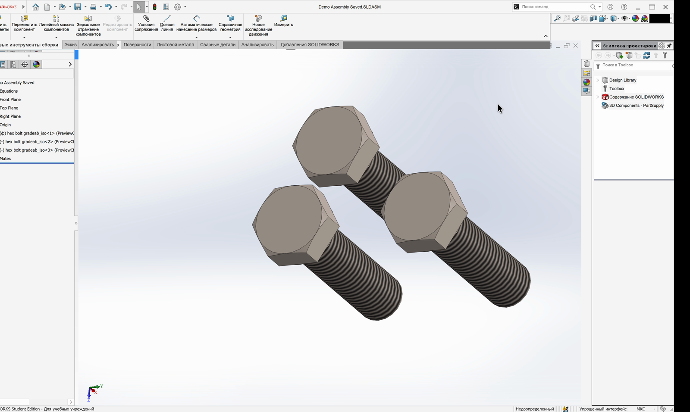

# SOLIDWORKS 2025 на Apple Silicon

**V3 · экспериментальный запуск Windows-версии в macOS через Wine и Rosetta**

[Скачать лаунчер](https://github.com/NazarKaratash13/Porting-Solidworks-2025-on-MacOS-in-Apple-Silicon/releases/tag/v0.2.0) · [Демонстрация](#демонстрация) · [Установка](#установка) · [Замеры](#замеры)

Windows-версия SOLIDWORKS запускается на Mac с Apple Silicon без гостевой Windows. V3 связывает её с Finder и диалогами macOS. Лаунчер запускает официальный установщик в отдельном окружении Wine и упаковывает готовую установку в один локальный `SOLIDWORKS 2025.app`. Для работы нужна действующая лицензия SOLIDWORKS.

## Демонстрация

В 89-секундном ролике показаны запуск, вращение детали, вставка третьего болта ISO из Toolbox, сохранение и повторное открытие сборки. В конце приведены результаты замеров на Mac с M4. [Смотреть или скачать MP4](https://github.com/NazarKaratash13/Porting-Solidworks-2025-on-MacOS-in-Apple-Silicon/releases/download/v0.2.0/SOLIDWORKS-V3-Demo-RU.mp4).

| Возможность | Статус |
| --- | --- |
| Запуск SOLIDWORKS 2025 SP05 Student Edition | Проверен на установленной V3, Mac с M4 |
| Детали, сборки и Toolbox | Вставлен болт ISO, сохранена и повторно открыта тестовая сборка |
| «Открыть», «Сохранить как» и Pack and Go | Реализованы диалоги macOS и интеграция с файловыми операциями SOLIDWORKS |
| Finder | Расширения Quick Look показывают встроенные эскизы документов, если они сохранены в файле |
| Сборка одного `.app` лаунчером | Проверена на имитации установки. Совместимость чистой установки с разными дистрибутивами Wine и активация требуют проверки |
| Перекомпиляция Windows-кода для ARM64 | Отдельная экспериментальная часть проекта |

## Установка

Понадобятся Mac с Apple Silicon, macOS 14 или новее, Rosetta, совместимая сборка Wine с исправлениями V3, официальный установщик SOLIDWORKS 2025 и лицензия для выбранной редакции. Замеры выполнены с окружением CrossOver 26.3.0. Обычная сборка Wine может не поддерживать функции V3. Точный набор модулей описан в [инструкции по сборке](MACOS_BUILD.md).

1. Скачайте DMG или ZIP для Apple Silicon и проверьте файл по `SHA256SUMS.txt`. Откройте DMG и перетащите лаунчер в «Программы». Для ZIP распакуйте архив и перенесите приложение в ту же папку. [Файлы релиза](https://github.com/NazarKaratash13/Porting-Solidworks-2025-on-MacOS-in-Apple-Silicon/releases/tag/v0.2.0).
2. Откройте лаунчер, выберите папку Wine и при необходимости укажите папку проектов. Она будет доступна в Wine как диск `W:`.
3. Нажмите **Начать установку…**, выберите `setup.exe` из официального дистрибутива и завершите шаги штатного установщика SOLIDWORKS.
4. После завершения установщика выберите папку назначения. Лаунчер соберёт `SOLIDWORKS 2025.app` со своей иконкой, выбранным Wine, установкой и расширениями Finder. Можно выбрать «Программы», если запись в эту папку доступна.
5. При первом запуске пройдите штатную активацию, если её запросит SOLIDWORKS. Рабочие файлы Wine хранятся в `~/Library/Application Support/org.swv3.desktop`.

Релизный лаунчер имеет локальную подпись ad hoc. На другом Mac Gatekeeper может потребовать пакет с подписью Developer ID и нотарификацией Apple. Доступна также [сборка лаунчера из исходников](MACOS_BUILD.md#build-the-setup-launcher). Если SOLIDWORKS уже установлен в совместимом Wine, его окружение можно [упаковать локальной командой](MACOS_BUILD.md#package-your-existing-installation).

## Замеры

Один Mac с M4 и 16 ГиБ памяти, macOS 27.2.1, SOLIDWORKS 2025 SP05 Student Edition. Медиана трёх запусков до загрузки тестовой сборки — **27,42 с**.

| Документ | Открытие | Перестроение | Сохранение копии |
| --- | ---: | ---: | ---: |
| Деталь | 2,480 с | 0,359 с | 0,223 с |
| Тестовая сборка Toolbox | 3,607 с | 0,464 с | 0,233 с |

Сумма physical footprint процессов SOLIDWORKS и `wineserver` выросла с **2,60 ГиБ** при двух открытых документах до **4,52 ГиБ** при одиннадцати. Замеры выполнялись на лёгких моделях, документы оставались открытыми между проходами. [Методика, исходные результаты и команда воспроизведения](BENCHMARKS_RU.md).

## Исходники

| Путь | Содержимое |
| --- | --- |
| [tools/solidworks-public](../tools/solidworks-public) | Лаунчер AppKit, упаковка и проверка синтетической установки |
| [tools/solidworks-macos](../tools/solidworks-macos) | Упаковка существующего локального Wine-окружения |
| [tools/solidworks-quicklook](../tools/solidworks-quicklook) | Расширения Finder для миниатюр и просмотра |
| [tools/solidworks-bench](../tools/solidworks-bench) | Замеры запуска, операций и памяти |
| [docs/patches](patches) | Патчи совместимости и порядок сборки |
| [recompiler](../recompiler) | Экспериментальная перекомпиляция |
| [docs](.) | Архитектура, аудит и воспроизведение |

Ветки разработки описаны в [архитектуре](ARCHITECTURE_RU.md) и [дорожной карте](ROADMAP_NO_WINE_RU.md). Для правок см. [CONTRIBUTING.md](../CONTRIBUTING.md). Для отчёта о сбое приложите версии macOS, Wine и SOLIDWORKS, шаги воспроизведения и обезличенный журнал. [Открыть Issue](https://github.com/NazarKaratash13/Porting-Solidworks-2025-on-MacOS-in-Apple-Silicon/issues).

## Лицензия

Собственные исходники проекта распространяются по [MIT](../LICENSE). Компоненты Wine распространяются на условиях [LGPL](../licenses/Wine-LGPL-2.1.txt). GitHub-релиз содержит лаунчер и материалы демонстрации. Установочные файлы SOLIDWORKS, коммерческую среду Wine и лицензию пользователь получает у соответствующих поставщиков.

Независимый проект для Apple Silicon. SOLIDWORKS — торговая марка Dassault Systèmes.
