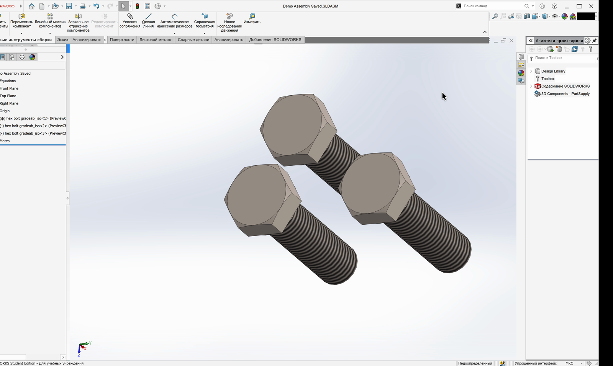

# SOLIDWORKS 2025 on Apple Silicon

V3 is an independent project for running the Windows edition of SOLIDWORKS on Apple Silicon through Wine and Rosetta. It includes a macOS setup launcher, Finder integration, and compatibility patches.

[Graphics preview v0.3.0-preview.1](https://github.com/NazarKaratash13/Porting-Solidworks-2025-on-MacOS-in-Apple-Silicon/releases/tag/v0.3.0-preview.1) · [Stable launcher v0.2.0](https://github.com/NazarKaratash13/Porting-Solidworks-2025-on-MacOS-in-Apple-Silicon/releases/tag/v0.2.0) · [Benchmarks](BENCHMARKS.md)

## Install the launcher

1. Download the Apple Silicon DMG or ZIP and verify it with `SHA256SUMS.txt`. Copy **SOLIDWORKS V3 Launcher** to Applications.
2. Choose a compatible, self-contained Wine runtime. You can optionally expose a projects folder as drive `W:`.
3. Choose **Start Installation…** and select `setup.exe` from your official SOLIDWORKS 2025 installation media. Complete installation in the SOLIDWORKS installer.
4. Choose **Build App…** to package the installed program as a private `SOLIDWORKS 2025.app`. Complete normal license activation if prompted.

The launcher needs macOS 14 or later, Apple Silicon, and a compatible Wine runtime. The public builds are ad hoc signed. They have no Developer ID signature or notarization. [Build from source](MACOS_BUILD.md).

## Try Vertex Span

The graphics preview batches adjacent legacy vertex calls inside WineMetalGL. It preserves submission order and falls back to the previous path for display list compilation, tracing, and incompatible draw state.

Vertex Span uses a separate private app, an isolated profile, and an OpenGL fallback. Building the preview requires the matching graphics modules and your own licensed SOLIDWORKS installation. The setup launcher DMG and ZIP contain the launcher, Quick Look extensions, and file bridge. [Build and test the private graphics preview](GRAPHICS_PREVIEW.md).

## Measured results

| Workload on Apple M4, 16 GiB | Result |
| --- | --- |
| MyCNC, 733 occurrences, full-detail rotation | 16.30 / 16.55 / 15.95 FPS in the signed laboratory package |
| Motor from SPECapc, 42 occurrences, full-detail rotation | 18.66 / 17.82 / 18.53 FPS in the independent viewport test |
| SPECapc for SOLIDWORKS 2025 | The runner opened TeapotOIT and stopped at the RealView prerequisite. No SPEC score was generated. |

The 30 FPS target for MyCNC remains open. See [the benchmark protocol, raw measurements, and limitations](BENCHMARKS.md).

## Source and support

- [Launcher and packaging](../tools/solidworks-public)
- [Viewport benchmark and WGL fixture](../tools/solidworks-bench)
- [Wine compatibility patches](patches/MANIFEST.md)
- [Development and architecture](DEVELOPMENT.md)
- [Contributing](../CONTRIBUTING.md)

This project is independent of Dassault Systèmes. SOLIDWORKS and SPECapc are trademarks of their respective owners. Obtain the SOLIDWORKS installer, license, and commercial Wine runtime from their providers. The project's original tooling is [MIT licensed](../LICENSE). Driver patches retain the applicable upstream licenses. [Wine](../licenses/Wine-LGPL-2.1.txt) · [WineMetalGL](../licenses/WineMetalGL-LGPL-3.0.txt).
